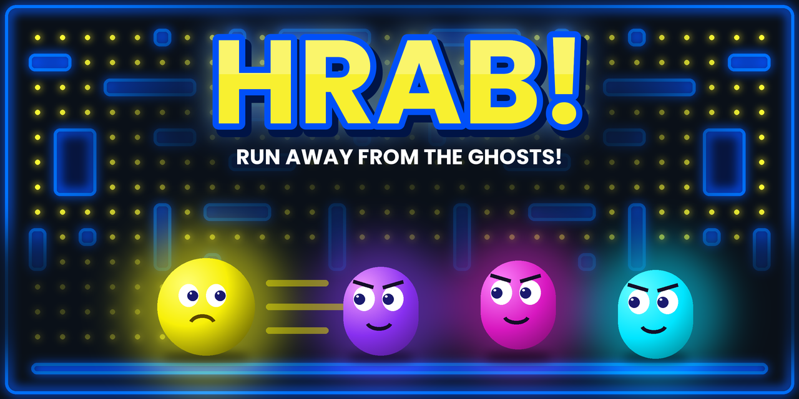

# HRAB! 

> *"Hrab!"* means **"Run away!"** in Tunisian. And that's exactly what you'll do.

A neon maze chase game built with **Unity 6**. Collect every coin in the maze
while three relentless enemies hunt you down, each one faster than the last.

## 🎮 Gameplay
- Collect **all the coins** to win
- **3 enemies** (Cyan, Magenta, Violet) leave the center house and chase you,
  each at a different speed
- You have **3 lives**: get caught and the round resets
- Lose all your lives and it's **Game Over**

## ✨ Features
- Enemy AI with **Unity AI Navigation** (NavMesh pathfinding)
- HUD built with **UI Toolkit** (UXML / USS): score and lives
- Main menu with **Play / Settings (volume) / Exit** (UI Canvas + TextMeshPro)
- Game Over and You Win screens with a **Replay** button
- Teleporters on the sides of the maze
- Press **Esc** or **M** in game to return to the menu

## 🕹️ Controls
| Key | Action |
|---|---|
| Arrows / WASD | Move |
| Esc / M | Back to menu |

## 🛠️ Built with
Unity 6 (6000.6.5f1) · URP · Input System · AI Navigation · UI Toolkit · TextMeshPro

## ▶️ Run it
1. Clone the repo
2. Open it with **Unity 6000.6.5f1** in Unity Hub
3. Open `Assets/MainMenu.unity` and press **Play**

---
Made by **Samar Zeidi** – ESPRIT, Extended Reality Applications course (4SSA9)
